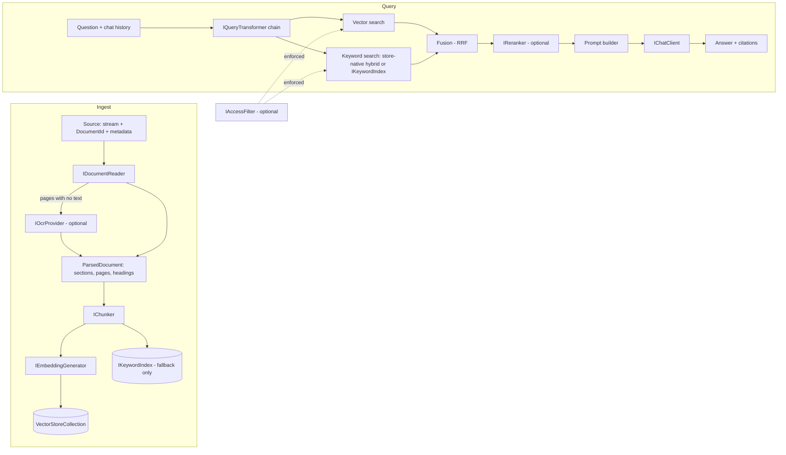

# RagDotNet — Design

**Status:** Draft for review
**Date:** 2026-10-18
**Owner:** HAS

Decisions marked *(builder's call)* were made by the assistant during design, not by the owner. They can be revisited without asking.

---

## 1. Intent

RagDotNet is a reusable .NET library that apps install from NuGet to add **retrieval-augmented generation (RAG)** over their own documents.

It is **thin and opinionated**:

- It builds on the standard .NET AI abstractions: **Microsoft.Extensions.AI** (`IChatClient`, `IEmbeddingGenerator<string, Embedding<float>>`) and **Microsoft.Extensions.VectorData** (`VectorStore`, `VectorStoreCollection<TKey, TRecord>`).
- Apps bring their own LLM, embedding provider, and vector store. RagDotNet never talks to a specific vendor directly.
- The library's job is the pipeline in between: **read → chunk → embed → store → retrieve → (rerank) → generate**, plus document lifecycle, chat, and observability.

### Why it exists

Microsoft's options either do too much (Kernel Memory: its own abstractions and a hosted service) or are still preview and ingestion-only (`Microsoft.Extensions.DataIngestion`). RagDotNet gives apps a stable, DI-friendly RAG pipeline on top of the standard abstractions, without locking them into a host or a vendor.

### Relationship to Microsoft.Extensions.DataIngestion

`Microsoft.Extensions.DataIngestion` (preview, around `10.11.0-preview` at the time of writing) provides readers, chunkers, and an ingestion pipeline. RagDotNet:

- defines its **own small interfaces** (`IDocumentReader`, `IChunker`) in Core, so the stable API never depends on a preview package;
- ships an optional **`RagDotNet.DataIngestion`** adapter package that wraps Microsoft's readers and chunkers as RagDotNet readers and chunkers.

---

## 2. Goals, non-goals, anti-goals

### Goals (v1)

1. Ingest text, Markdown, PDF, DOCX, and HTML, with OCR for scanned PDF pages and embedded images.
2. Three chunking strategies: structure-aware (default), fixed-size token windows, semantic.
3. Vector retrieval, with hybrid (vector + keyword) retrieval and optional reranking.
4. Two API levels: `RetrieveAsync` (chunks only) and `AskAsync` / `AskStreamingAsync` (answers with citations).
5. Multi-turn chat: follow-up questions are rewritten into standalone ones before retrieval.
6. Query transformation: condense, multi-query, HyDE.
7. Idempotent document lifecycle: upsert by ID with change detection, delete, metadata filters.
8. Enforced access filtering (tenants and permissions) when the app opts in.
9. Background ingestion queue for hosted apps.
10. OpenTelemetry-compatible tracing and metrics with no OpenTelemetry package dependency.
11. A retrieval evaluation harness (recall@k) to choose defaults with evidence.
12. Zero configuration to start, with options and interfaces to tune and extend.

### Non-goals (v1)

- Talking to specific LLM or vector vendors directly. That's the job of Microsoft.Extensions.AI and VectorData connectors.
- A hosted server, REST API, or UI.
- Durable (restart-safe) ingestion jobs. The interface allows apps to plug one in.
- Agentic or tool-calling RAG.
- Prompt-injection *detection* (classifiers or extra LLM calls).

### Anti-goals (would be a failure even if it works)

- Core pulling in heavy or native dependencies (PDF parsers, Tesseract, Lucene, Hosting).
- Core depending on a preview package.
- Silently wrong results: mixing vectors from different embedding models, silently skipping pages that have no text, or bypassing a registered access filter.
- A public API that forces DI on scripts and tests.

---

## 3. Constraints

- **Target frameworks:** `net8.0;net10.0` for every shipped package.
- **License:** MIT.
- **Package naming:** `RagDotNet.*`. Check that the names are free on NuGet before the first publish.
- **Dev machine:** Windows, Core Ultra 7 266V, 16 GB RAM, Intel Arc 140V iGPU (no CUDA). The .NET 10 SDK, .NET 8 runtime, Docker, and Ollama are installed.
- **Local models:** `nomic-embed-text` (768 dimensions) and `llama3.2:3b` (about 38 tokens/s on CPU) via Ollama.
- Unit tests and CI must never need a model, network access, or Docker.

---

## 4. Packages

| Package | Contents | Notable dependencies |
|---|---|---|
| `RagDotNet.Core` | Pipeline, interfaces, text/Markdown readers, all three chunkers, in-memory keyword index, query transformers, DI + builder, telemetry | Microsoft.Extensions.AI.Abstractions, Microsoft.Extensions.VectorData.Abstractions, Microsoft.ML.Tokenizers, Markdig *(builder's call)*, Microsoft.Extensions.Options / DependencyInjection.Abstractions / Logging.Abstractions |
| `RagDotNet.Readers.Pdf` | PDF reader with page numbers | PdfPig |
| `RagDotNet.Readers.Docx` | DOCX reader with heading paths | DocumentFormat.OpenXml |
| `RagDotNet.Readers.Html` | HTML reader with heading paths; strips boilerplate | AngleSharp |
| `RagDotNet.Ocr.Tesseract` | `IOcrProvider` implementation; renders pages and images to bitmaps and runs OCR | Tesseract (NuGet wrapper), PDFtoImage (PDFium) |
| `RagDotNet.Keyword.Lucene` | File-persisted `IKeywordIndex` | Lucene.NET 4.8 (**prerelease**, so this package ships as prerelease) |
| `RagDotNet.Hosting` | Background ingestion queue (`IHostedService`) | Microsoft.Extensions.Hosting.Abstractions |
| `RagDotNet.DataIngestion` | Adapters for Microsoft.Extensions.DataIngestion readers and chunkers | Microsoft.Extensions.DataIngestion (**preview**, so this package ships as prerelease) |

Core contains no parser, native, or preview dependency.

---

## 5. Architecture



### 5.1 Ingestion

1. The caller calls `IngestAsync(DocumentSource source, IngestOptions? options)`.
   - `DocumentSource` holds: `DocumentId` (string, caller-supplied and stable), `Stream` or file path, `ContentType` / file name, and `Metadata` (`IDictionary<string, object?>`).
2. **Change detection:** the library computes a SHA-256 hash of the raw bytes, plus a hash of the effective chunking configuration *(builder's call)*.
   - If a document with this ID exists and both hashes match, nothing happens and the result is `Unchanged`.
   - Otherwise the new chunks are written first, then any old chunks for that ID that weren't overwritten are deleted. Chunk keys are deterministic (`{DocumentId}:{ChunkIndex}`, hashed to a Guid for stores that need Guid keys), so overwriting is natural.
3. **Reader selection:** the first registered `IDocumentReader` whose `CanRead(contentType, fileName)` returns true. Text and Markdown readers are in Core. Unknown formats throw `UnsupportedDocumentException`.
4. **Reader output:** a `ParsedDocument`, which is an ordered list of blocks (heading, paragraph, list, table, code), each with `PageNumber?` and `HeadingPath` (for example `["Install", "Linux"]`).
5. **OCR:** if an `IOcrProvider` is registered and a reader reports a page or image with no extractable text, the provider produces text for it. If no provider is registered, the page is **reported as a warning** in `IngestResult.Warnings`. It is never silently skipped.
6. **Chunking** produces `Chunk { Index, Text, PageStart?, PageEnd?, HeadingPath, TokenCount }`.
7. **Embedding:** chunks are embedded in batches (`EmbeddingBatchSize`, default 32 *(builder's call)*).
8. **Write:** upsert into the vector collection, and into the `IKeywordIndex` if the fallback keyword index is active.
9. **Result:** `IngestResult { Status (Created | Updated | Unchanged), ChunkCount, Warnings }`.
10. Ingestion supports `IProgress<IngestProgress>` and `CancellationToken`.

Also provided:

- `IngestManyAsync` ingests several documents with bounded parallelism.
- `DeleteDocumentAsync(documentId)` deletes from the vector store and the keyword index. The access filter applies.
- `ReindexAsync()` re-embeds every stored chunk from its stored text with the currently configured embedding generator, then updates `EmbeddingModelId`. It does not re-read the source files.

### 5.2 Storage schema (owned by the library)

The library defines one record shape using `VectorStoreCollectionDefinition`, so the embedding dimension and key type are set at runtime.

| Field | Type | Notes |
|---|---|---|
| `Key` | `string` or `Guid` (config: `KeyType`) | Deterministic from DocumentId + ChunkIndex |
| `DocumentId` | string | Filterable |
| `ChunkIndex` | int | |
| `Text` | string | Full-text indexed (enables store-native hybrid search) |
| `ContentHash` | string | Document-level hash |
| `ChunkingHash` | string | Hash of the effective chunking config |
| `EmbeddingModelId` | string | See 5.3 |
| `PageStart`, `PageEnd` | int? | PDF citations |
| `HeadingPath` | string | Joined with ` > ` |
| `SourceName` | string | File name or title for display |
| `Metadata` | flattened `meta_*` data properties *(builder's call)* | Filterable; keys declared up front in options so they can be indexed |
| `Embedding` | `ReadOnlyMemory<float>`, `Dimensions` from config | Distance: cosine |

Apps configure only `CollectionName`, `EmbeddingDimensions`, `KeyType`, and the declared filterable metadata keys.

### 5.3 Embedding model safety

- Every chunk stores `EmbeddingModelId`. It comes from the generator's metadata (`EmbeddingGeneratorMetadata.DefaultModelId`) or `RagOptions.EmbeddingModelId`; the explicit option wins.
- On first use, the pipeline samples stored records. If any stored `EmbeddingModelId` differs from the configured one, it throws `EmbeddingModelMismatchException`, naming both IDs and pointing to `ReindexAsync()`.
- Writing a new chunk under a different model ID is also refused.

### 5.4 Chunking

`IChunker.ChunkAsync(ParsedDocument, ChunkingOptions, CancellationToken) → IReadOnlyList<Chunk>`

| Strategy | Behaviour | Default settings |
|---|---|---|
| **StructureAware** (default) | Splits on headings first, then paragraphs and blocks, then sentences. Merges small neighbouring blocks under the same heading. Never splits inside a code block or table row unless the block alone exceeds the token limit. | MaxTokens 512, Overlap 10% *(builder's call)* |
| **FixedSize** | Sliding token window over the flattened text | MaxTokens 512, Overlap 64 |
| **Semantic** | Splits into sentences, embeds them, and breaks where the cosine distance between neighbours exceeds a percentile threshold; respects MaxTokens. **Makes embedding calls during ingest.** | Breakpoint percentile 95 |

- Tokens are counted with `Microsoft.ML.Tokenizers` (`TiktokenTokenizer` for `cl100k_base` by default). Apps can supply their own `Tokenizer`. Counts are approximate for non-OpenAI embedding models, and the docs say so.
- Settings come from global defaults in `RagOptions.Chunking`, which can be overridden per ingest call or per content type.
- The final defaults will be confirmed with the evaluation harness (see 9.3) before v1 ships.

### 5.5 Retrieval

`RetrieveAsync(string query, RetrievalOptions? options) → IReadOnlyList<RetrievedChunk>`

`RetrievedChunk` holds the text, score, DocumentId, ChunkIndex, pages, HeadingPath, SourceName, and metadata.

Steps:

1. Run the configured `IQueryTransformer` chain (see 5.7). It may produce several queries.
2. For each query:
   - **Vector search** on the collection.
   - **Keyword search**, if `Hybrid` is enabled:
     - If the collection implements `IKeywordHybridSearchable<TRecord>`, use the store-native hybrid search (one call that already fuses both).
     - Otherwise, if an `IKeywordIndex` is registered, run a BM25 search on it and fuse the results with the vector results using **reciprocal rank fusion** (k = 60 *(builder's call)*).
     - Otherwise, use vector search only and log a one-time warning.
3. Merge the results of multiple queries with RRF and remove duplicates by key.
4. **Access filter + caller filter:** the `IAccessFilter` filter (if registered) is ANDed with the caller's `Filter` and applied inside every store and keyword query. It is not applied afterwards, so `TopK` stays correct.
5. **Optional `IReranker`:** reorders the top `RerankCandidates` (default 20) down to `TopK`.
6. Apply `MinScore`, then `TopK` (default 5).

`RetrievalOptions` contains: `TopK`, `MinScore`, `Filter` (VectorData filter expression over the declared metadata and DocumentId), `Hybrid` (on/off/auto, default auto), `UseReranker`, and `QueryTransformers` (an override).

### 5.6 Generation

```csharp
Task<RagAnswer> AskAsync(string question, AskOptions? options = null, CancellationToken ct = default);
Task<RagAnswer> AskAsync(IList<ChatMessage> conversation, AskOptions? options = null, CancellationToken ct = default);
IAsyncEnumerable<RagAnswerUpdate> AskStreamingAsync(...same overloads...);
```

- `RagAnswer` holds `Text`, `Citations` (`[n]` → RetrievedChunk), `RetrievedChunks`, `Usage`, and `IsAnswered` (false when the model reports there wasn't enough information).
- **Prompt:**
  - A default system prompt that can be replaced (`RagOptions.Prompt` as `IRagPromptBuilder`).
  - Retrieved chunks are numbered and wrapped in delimiters: `<document id="n" source="..." page="...">…</document>`.
  - The prompt tells the model to treat document content as data, not instructions; to answer only from the documents; to cite with `[n]`; and to say it doesn't know when the documents don't contain the answer.
- **Context budget:** chunks are added in rank order until `MaxContextTokens` (default 3000 *(builder's call)*) is reached.
- **Citations:** `[n]` markers are parsed from the answer and mapped back to chunks. Markers that point to no chunk are dropped. For PDF chunks a citation shows the page; for DOCX, HTML, and Markdown it shows the heading path *(builder's call)*.
- **Streaming:** text deltas are streamed as they arrive. A final update carries the citations and usage.

### 5.7 Chat and query transformation

`IQueryTransformer.TransformAsync(QueryContext) → IReadOnlyList<string>`. `QueryContext` holds the current question and the chat history.

| Transformer | Behaviour | Default |
|---|---|---|
| **Condense** | When there is chat history, uses the `IChatClient` to rewrite the latest question as a standalone question | **On** whenever history is present |
| **MultiQuery** | Generates N alternative phrasings (default 3) | Off |
| **HyDE** | Generates a hypothetical answer and embeds that instead of the question | Off |

- Transformers chain in order. Condense always runs first.
- The original question is still what goes into the final answer prompt, together with the conversation.

### 5.8 Access control

- `IAccessFilter.GetFilterAsync(CancellationToken)` returns a filter expression (for example `tenant == "acme"`), typically built from the current user via DI scope.
- When registered, it is **always** ANDed into retrieval, deletion, and `ReindexAsync`. Callers cannot opt out through the public API.
- When not registered, there is no filtering beyond what the caller passes.
- The prompt-injection mitigation (delimiters plus instructions) is documented as **risk reduction, not a guarantee**.

### 5.9 Keyword index (fallback)

- `IKeywordIndex` provides `UpsertAsync(chunks)`, `DeleteDocumentAsync(id)`, `SearchAsync(query, filter, top)`, and `RebuildAsync(source)`.
- It is used **only** when the vector collection doesn't support native hybrid search.
- **InMemoryKeywordIndex** (Core):
  - BM25 with k1 = 1.2 and b = 0.75 *(builder's call)*.
  - Lazily rebuilt at startup by scanning the vector store. Small to medium corpora only, and the docs say so.
  - Filters are evaluated against the same metadata.
- **LuceneKeywordIndex** (`RagDotNet.Keyword.Lucene`):
  - A file-backed index in a configured directory, using `StandardAnalyzer` *(builder's call)*.
  - It must be kept in step with the vector store. If the two disagree (detected by a chunk-count check at startup), the Lucene index is rebuilt.

### 5.10 Reranking

- `IReranker.RerankAsync(query, candidates, top) → reordered list with scores`.
- v1 ships **`LlmReranker`**, which asks the `IChatClient` to score each candidate's relevance (batched, one call per candidate group). It is opt-in.
- Apps can plug in cross-encoder or cloud rerankers through the interface.

### 5.11 OCR (`RagDotNet.Ocr.Tesseract`)

- `IOcrProvider.RecognizeAsync(ImageInput) → OcrResult(text, confidence)`.
- Covers PDF pages with no text layer (rendered with PDFtoImage at 300 DPI *(builder's call)*) and embedded images in DOCX and HTML (where the image bytes are available locally).
- Language data folder and languages (default `eng`) are set in options. Language data files are **not bundled**.
- Platforms: Windows x64 is fully supported. Linux and macOS require a native Tesseract installation; the docs say so.
- Text below a minimum confidence threshold is still kept, but flagged with a warning.

### 5.12 Background ingestion (`RagDotNet.Hosting`)

- `IIngestionQueue` provides `EnqueueAsync(DocumentSource) → JobId`, `GetStatusAsync(JobId) → Queued | Running | Succeeded(IngestResult) | Failed(error, attempts)`, and `CancelAsync(JobId)`.
- **Default implementation:**
  - A bounded `System.Threading.Channels` queue, processed by an `IHostedService` worker.
  - Configurable concurrency (default 2), with retries using exponential backoff (default 3 attempts) on transient errors.
  - Statuses are kept in memory for a configurable retention period.
- **Not durable:** jobs that haven't finished are lost on restart, and the docs say so. Apps can register their own durable `IIngestionQueue`.
- Stream lifetime: the queue copies the stream to a temporary file on enqueue, unless the source is a file path *(builder's call)*.

### 5.13 Observability

- `ActivitySource` and `Meter`, both named `RagDotNet`.
- **Spans:** `rag.ingest`, `rag.read`, `rag.ocr`, `rag.chunk`, `rag.embed`, `rag.store`, `rag.retrieve`, `rag.transform`, `rag.rerank`, `rag.generate`.
- **Metrics:** ingest duration, chunks per document, retrieval latency, retrieved count, context tokens, unanswered-question count.
- Follows the OpenTelemetry semantic conventions for generative AI where they apply. No document text appears in telemetry unless `EnableSensitiveData` is set.
- `ILogger` is used for warnings (for example missing hybrid search or skipped pages).

### 5.14 Configuration

**With DI:**

```csharp
services.AddRag(o =>
{
    o.CollectionName = "docs";
    o.EmbeddingDimensions = 768;
    o.FilterableMetadata = ["tenant", "category"];
})
.AddPdfReader()
.AddDocxReader()
.AddHtmlReader()
.AddTesseractOcr(o => o.DataPath = "./tessdata")
.AddLuceneKeywordIndex(o => o.Directory = "./kw-index")
.AddLlmReranker()
.AddAccessFilter<TenantAccessFilter>();
// The app separately registers IChatClient, IEmbeddingGenerator, and VectorStore.
```

- Options bind from `IConfiguration` through the standard `IOptions<RagOptions>` pattern, with validation at startup.

**Without DI:**

```csharp
var rag = new RagPipelineBuilder()
    .UseChatClient(chat)
    .UseEmbeddingGenerator(embedder)
    .UseVectorStore(store, "docs", dimensions: 768)
    .AddReader(new PdfReader())
    .Build();
```

The public entry point is `IRagPipeline`, which exposes `IngestAsync`, `IngestManyAsync`, `DeleteDocumentAsync`, `ReindexAsync`, `RetrieveAsync`, `AskAsync`, and `AskStreamingAsync`.

---

## 6. Error handling

| Situation | Behaviour |
|---|---|
| Unsupported format | `UnsupportedDocumentException` |
| Embedding model mismatch | `EmbeddingModelMismatchException` (fail fast) |
| Page with no text and no OCR provider | Warning in `IngestResult`; processing continues |
| Embedding or chat provider fails | Exception passes through (no hidden retries in Core). The Hosting queue retries. |
| Partial failure while writing chunks | The new chunks are idempotent. Old chunks are deleted only after all new chunks are written, so a retry converges. |
| Hybrid search requested but unavailable | Falls back to vector-only search, with a one-time warning log |
| Missing required options | `OptionsValidationException` at startup |

---

## 7. Repository layout *(builder's call)*

```
RagDotNet.slnx
Directory.Build.props        # net8.0;net10.0, nullable, warnings as errors, LangVersion latest, SourceLink, MinVer
Directory.Packages.props     # central package management
LICENSE (MIT), README.md, .editorconfig, .gitignore
src/
  RagDotNet.Core/
  RagDotNet.Readers.Pdf/
  RagDotNet.Readers.Docx/
  RagDotNet.Readers.Html/
  RagDotNet.Ocr.Tesseract/
  RagDotNet.Keyword.Lucene/
  RagDotNet.Hosting/
  RagDotNet.DataIngestion/
tests/
  RagDotNet.Core.Tests/                 # plus one test project per package
  RagDotNet.IntegrationTests/           # opt-in: RAGDOTNET_INTEGRATION=1
  RagDotNet.Evaluation/                 # recall@k harness (not packed)
  TestAssets/                           # sample corpus: md, pdf (incl. a scanned page), docx, html
samples/
  RagDotNet.Samples.Console/            # Ollama by default; provider switchable via config
.github/workflows/ci.yml
docs/
```

- Public API is tracked with `Microsoft.CodeAnalysis.PublicApiAnalyzers`. XML documentation is required on public types.
- The test framework is xUnit v3.

---

## 8. Providers for samples and tests

- The sample app and integration tests choose a provider from config (`Provider = Ollama | GitHubModels | OpenAI`):
  - **Ollama** (default): `http://127.0.0.1:11434`, `nomic-embed-text` (768 dimensions) and `llama3.2:3b`.
  - **GitHub Models** or **OpenAI**: need an API token from environment variables.
- **Vector stores for integration tests:**
  - The InMemory connector.
  - **Qdrant** in Docker via Testcontainers. It supports native hybrid search and needs Guid keys, which exercises both code paths.
- The Ollama server on the dev machine is started with `ollama serve`, because the desktop app fails to start there. This only affects local setup.

---

## 9. Testing

### 9.1 Unit tests (always run, CI)

- Fake `IEmbeddingGenerator` (deterministic: hashed bag of words → vector) and fake `IChatClient` (scripted replies).
- InMemory vector store.
- Coverage: every reader against the files in `TestAssets`; each chunker's edge cases; the lifecycle (unchanged, updated, deleted); the model mismatch error; access filter enforcement; RRF fusion; citation parsing; context budget; query transformer chaining; queue retries and statuses.

### 9.2 Integration tests (opt-in)

- Run when `RAGDOTNET_INTEGRATION=1` is set. They need Ollama, Docker, or both, and each test is skipped if its dependency isn't available.
- Coverage: an end-to-end ask over the sample corpus with Ollama; Qdrant hybrid search; Lucene persistence across restarts; Tesseract OCR on the scanned PDF page (Windows only).

### 9.3 Evaluation harness

- A small fixed corpus plus a question set (about 30–50 questions *(builder's call)*), each labelled with the chunk or section that answers it.
- Reports recall@k (k = 1, 3, 5) and MRR for each chunker, chunk size, and retrieval mode.
- **CI mode:** runs on fake embeddings. It only checks that the harness works; scores are not meaningful.
- **Real mode:** runs with Ollama and is opt-in. Its results decide the chunker defaults before v1 ships, and are recorded in `docs/evaluation.md`.

---

## 10. Build order (v1 = all stages complete)

1. **Core slice:**
   - Solution scaffold and Directory props.
   - Text and Markdown readers, structure-aware chunker, vector retrieval.
   - `AskAsync` and streaming with citations.
   - Lifecycle (hashing, upsert, delete), model-ID safety and `ReindexAsync`, access filter.
   - DI and builder, telemetry, sample console app.
2. **Chat and query transformation:** conversation overloads; Condense, MultiQuery, and HyDE.
3. **Evaluation harness:** the corpus, the questions, and both modes.
4. **Fixed-size and semantic chunkers**, measured with the harness, and the defaults confirmed.
5. **Reader packages:** PDF, DOCX, HTML.
6. **OCR:** `RagDotNet.Ocr.Tesseract`.
7. **Hybrid search and reranking:** store-native hybrid, `IKeywordIndex` (in-memory and Lucene), RRF, `LlmReranker`.
8. **Hosting and DataIngestion adapters:** `RagDotNet.Hosting` and `RagDotNet.DataIngestion`.
9. **CI and packaging:**
   - GitHub Actions: build, test, and pack on push and pull request.
   - Tag-triggered publish to nuget.org (run manually later).
   - README per package.

---

## 11. Risks

| Risk | Mitigation |
|---|---|
| Lucene.NET 4.8 is still prerelease | `RagDotNet.Keyword.Lucene` ships as prerelease; the in-memory index covers stable users |
| Microsoft.Extensions.DataIngestion is preview and changes often | Kept in an isolated adapter package that ships as prerelease |
| Microsoft.Extensions.VectorData API churn (frequent minor releases) | Pin a minimum version; use dynamic `VectorStoreCollectionDefinition` instead of attributes; cover with integration tests |
| Tesseract native support varies by OS | Separate package; Windows fully supported; native setup documented for other OSes |
| Semantic chunking cost and latency | Off by default; the harness decides whether it's worth recommending |
| Token counts are approximate for non-OpenAI models | Pluggable tokenizer; documented |
| v1 scope is large | The build order delivers a usable Core first; each stage is independently testable |

---

## 12. Left to the builder

Everything marked *(builder's call)* above, plus:

- internal class structure and naming
- exact option names
- logging wording
- test-case selection
- the sample corpus content
- the sample app's interaction design
